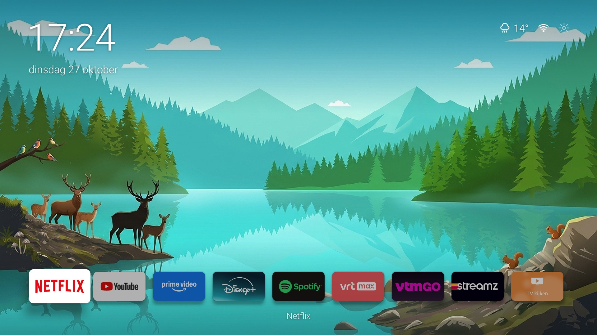
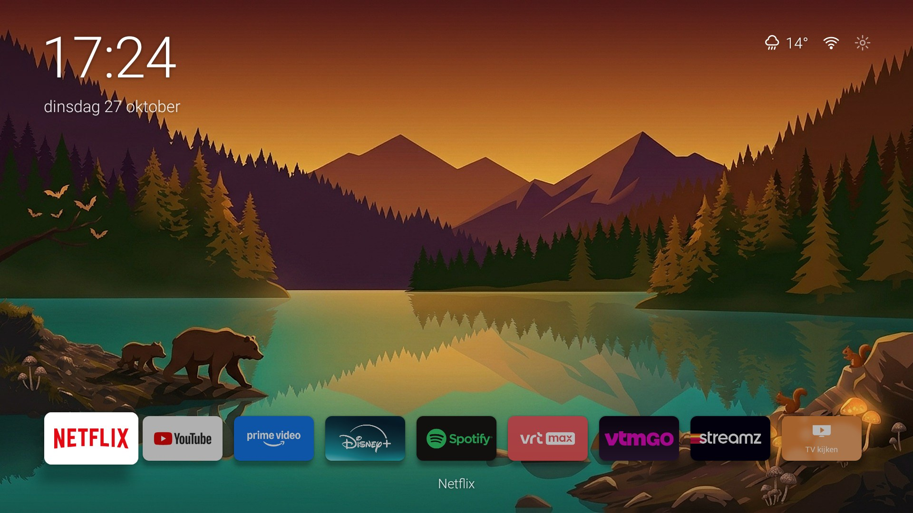
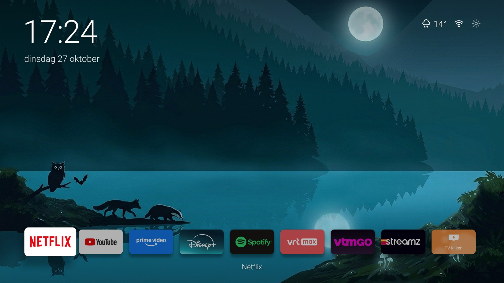
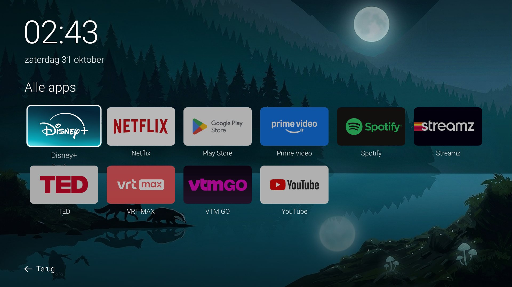
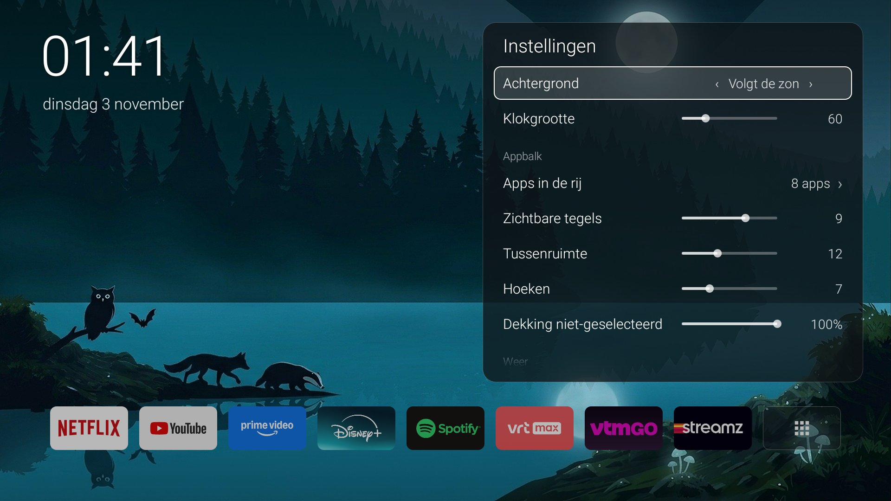
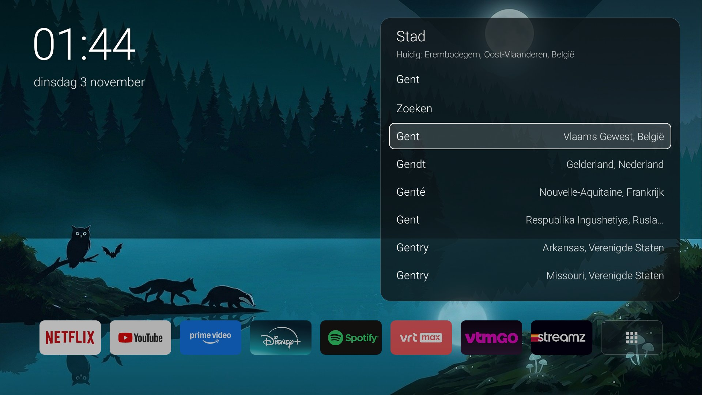
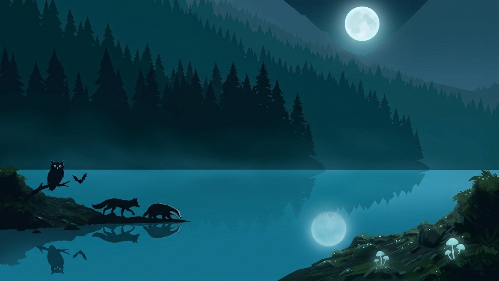
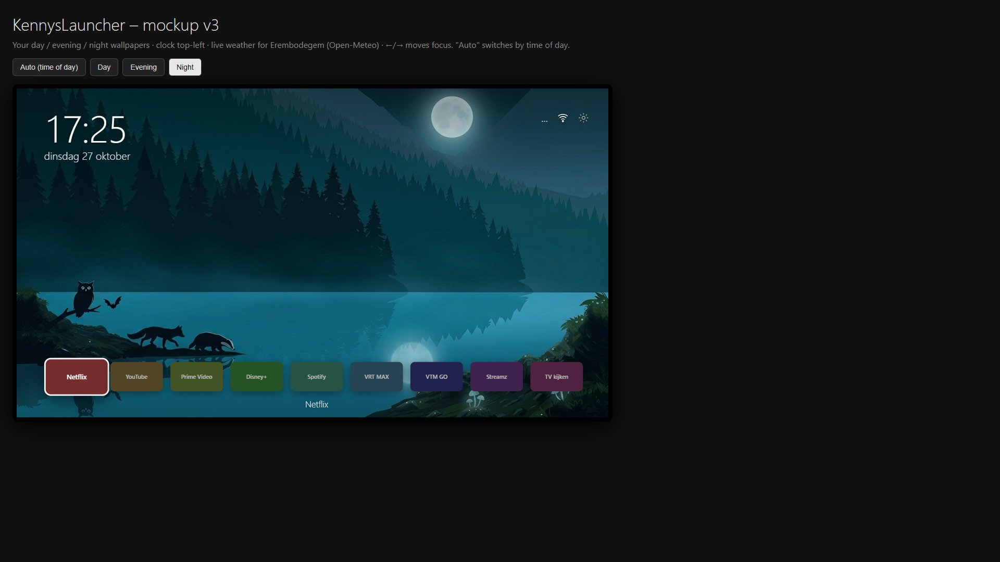

# Android TV Animalistic Launcher

A minimalistic, clutter-free home screen for Android TV: a big clock, live weather, one row of apps and a
hand-picked nature wallpaper that follows the real **sunrise and sunset**. No banners, no ads, no recommendations.



| Evening | Night |
|---|---|
|  |  |

> Screenshots are taken from the real TV (Philips 65PUS8102/12, Android TV 8.0, 1920x1080).
> App banners shown in the screenshots belong to their respective owners and are **not** part of this repository.
> The launcher reads them at runtime from the apps installed on the TV.

---

## Features

- **Big clock and date** in the top-left corner (`HH:mm` and the full weekday and date, Dutch/Belgian locale).
- **Live weather** (icon and temperature) from [Open-Meteo](https://open-meteo.com/). It needs no API key, refreshes every 30 minutes, and shows a moon icon on clear nights. Select the weather shortcut to open the **built-in forecast** (10 days by default, 5–16 configurable), shown in pages of five tiles, with colored weather icons, darker translucent tiles, feels-like temperature, rain probability, wind, and sunset.
- **Network status icon** for Ethernet, Wi-Fi or offline.
- **Launcher settings** behind the gear: wallpaper, clock size, the apps in the row, tile size/spacing/corners/opacity, weather city and forecast length. Changes preview live. See [Settings](#settings).
- **A single row of favorite apps** (up to 20, eight by default) with their official TV banners, loaded from the installed apps. When there are more apps than visible tiles, the row scrolls and wraps around like a carousel. The focused tile grows (never into its neighbors) and gets a white ring; the other tiles are dimmed.
- **An Apps tile** at the end of the row opens **Alle apps**, a full-screen grid of every installed TV app (including the Google Play Store), sorted alphabetically. Philips system entries (`org.droidtv.*`, such as Watch TV, channels and the app gallery) are hidden.
- **Wallpaper that changes with the sun** at the configured city (or a fixed day, evening or night wallpaper). It crossfades over 2 seconds between three phases:

  | Phase | When |
  |---|---|
  | Day | sunrise until 1 hour before sunset |
  | Evening | 1 hour before sunset until 1 hour after sunset |
  | Night | otherwise |

  Sunrise and sunset are calculated on the device (NOAA approximation), so no internet is needed for this.
- **No clutter.** It uses no AndroidX runtime libraries, no tracking, no ads or recommendation rows. BACK closes the forecast or the app grid, or returns from the status controls to the app row; it never exits the home screen.
- **Small.** It is about 1.7 MB, and most of that is the three wallpapers.

## Repository layout

```
.
├── app/                          Android app (Kotlin, no AndroidX runtime)
│   ├── src/main/
│       ├── AndroidManifest.xml   HOME + LEANBACK_LAUNCHER activity
│       ├── java/be/kenny/launcher/
│       │   ├── MainActivity.kt   Dashboard, navigation, clock, refresh lifecycle, network, wallpapers
│       │   ├── ForecastScreen.kt Native forecast UI, daily selection, loading/error states
│       │   ├── AppsScreen.kt     "Alle apps" grid of all installed TV apps
│       │   ├── SettingsScreen.kt Launcher settings panel (main page, app slots, add app, city search)
│       │   ├── SettingsViews.kt  Focus-trapping panel layout and the D-pad slider
│       │   ├── LauncherSettings.kt Settings model, ranges and SharedPreferences store
│       │   ├── Geocoding.kt      Open-Meteo city search
│       │   ├── Weather.kt        Open-Meteo request, current conditions, ten-day forecast parsing
│       │   ├── WeatherDisplay.kt Shared weather icons, descriptions, units and wind directions
│       │   └── Sun.kt            Sunrise/sunset and day/evening/night phase logic
│       └── res/
│           ├── drawable/         Vector icons (weather, wifi, gear) + scrims/focus shapes
│           ├── drawable-nodpi/   bg_day.jpg, bg_dusk.jpg, bg_night.jpg (1920x1080)
│           └── layout/           Dashboard, forecast screen, forecast day tiles, apps grid, settings panel
│   └── src/test/                 Local parser, native rendering and D-pad regression tests
├── wallpapers/                   Original AI-generated wallpapers (1365x768)
├── docs/
│   ├── images/                   Screenshots, mockup render, history/ (early procedural experiment)
│   └── mockup/mockup.html        Interactive HTML design mockup (placeholder tiles)
├── tools/
│   ├── remote/                   Python Android TV Remote v2 helpers (pair, send keys)
│   ├── wallpaper/                Legacy procedural wallpaper generator (Pillow)
│   └── removed-packages.txt      Debloat log of what was removed/disabled on the TV
└── .github/workflows/build.yml   CI: builds the debug APK on each push
```

## Requirements

- **JDK 17**, for example [Microsoft Build of OpenJDK](https://learn.microsoft.com/java/openjdk/download), installed with `winget install Microsoft.OpenJDK.17`.
- **Android SDK** with `platforms;android-34` and `build-tools;34.0.0`. Android Studio works, or the command-line tools alone:
  ```powershell
  sdkmanager "platforms;android-34" "build-tools;34.0.0" "platform-tools"
  ```
- An **Android TV** device running Android 8.0 (API 26) or newer.
- Optional: Python 3.10 or newer for the tools in `tools/`.

The Gradle wrapper is included, so you don't need to install Gradle.
The build uses Gradle 8.7, Android Gradle Plugin 8.5.2 and Kotlin 1.9.24.

## Build

```powershell
git clone https://github.com/kennysaelen/Android-tv-animalistic-launcher.git
cd Android-tv-animalistic-launcher

# Tell Gradle where the SDK is (or set ANDROID_HOME). This file is git-ignored.
"sdk.dir=$($env:LOCALAPPDATA -replace '\\','\\')\\Android\\Sdk" | Set-Content local.properties

$env:JAVA_HOME = "C:\Program Files\Microsoft\jdk-17.0.21.21-hotspot"   # adjust to your JDK 17
.\gradlew.bat assembleDebug
```

Output: `app/build/outputs/apk/debug/app-debug.apk`

On Linux or macOS, use `./gradlew assembleDebug`.
Each push to `main` also builds the APK in GitHub Actions and attaches it as a workflow artifact.

### Local checks

With the same JDK and SDK configuration:

```powershell
.\gradlew.bat assembleDebug lintDebug testDebugUnitTest --no-daemon
```

CI runs the same checks. The tests use JUnit and Robolectric, including native Android rendering and
D-pad input on API 26 and 34; no emulator, ADB connection, or TV is required. Robolectric's AndroidX
dependencies are test-only and are not packaged in the APK. Test data is synthetic and the tests do
not fetch live forecasts. Native UI renders of both pages with **test data**, not TV screenshots or
live weather, are written to `app/build/reports/forecast-ui-test.png` and
`app/build/reports/forecast-ui-page-2-test.png`.

## Install on the TV

1. Enable **developer options** on the TV: Settings → About → press *Build* 7 times.
2. Enable **USB debugging** (on some TVs called *Network debugging*).
3. Connect over the network and install:

   ```powershell
   adb connect <TV-IP>:5555
   adb install -r app\build\outputs\apk\debug\app-debug.apk
   ```

> **Troubleshooting ADB authorization:** if `adb devices` keeps showing `unauthorized` and the TV never shows
> the *Allow USB debugging?* dialog, do a **cold reboot**: pull the power plug, wait about 10 seconds, and plug it back in.
> The dialog appeared right after the TV booted.

### Make it the default home screen

**Gentle option (recommended).** This keeps the stock launcher installed and enabled, and only changes the preferred HOME activity:

```powershell
adb shell cmd package set-home-activity be.kenny.launcher/.MainActivity
```

To revert to the Google TV launcher:

```powershell
adb shell cmd package set-home-activity com.google.android.tvlauncher/.MainActivity
```

**Aggressive option.** This disables the stock launcher for the current user. You can undo it with `pm enable`:

```powershell
adb shell pm disable-user --user 0 com.google.android.tvlauncher
# undo:
adb shell pm enable com.google.android.tvlauncher
```

Pressing **HOME** on the remote now opens this launcher.

## Weather forecast

Press **UP** from an app tile to focus the dashboard weather shortcut, then **OK / D-pad center**
to open the forecast. Clicking the icon/temperature also works. **RIGHT** from the shortcut reaches
the settings gear; **DOWN** returns to the last focused app. The shortcut remains available before
the first weather update and when offline.

The forecast reuses the launcher's clock, nature wallpaper, location, and Open-Meteo connection.
It needs no separate weather app, account, API key, or additional permission.

- **LEFT / RIGHT** focuses a day and updates the detail area; **OK** selects it as well. Today shows
  the latest current conditions and measurement time. Other days show the predicted maximum
  temperature, with the feels-like temperature and wind explicitly labeled as daily maxima.
- Five dated tiles are shown at a time, with a range indicator such as **1–5 / 10** or **6–10 / 10**. Move
  past the last tile to focus **Volgende** (Next), then press **OK** to show the second page and
  select day 6. On the second page, move left from the first tile to **Vorige** (Previous), then
  press **OK** to return to the first page with day 5 selected. Clicking an enabled arrow also works.
  Merely focusing an arrow does not change the page or selected weather details.
- Pages do not wrap: Previous is hidden on the first page and Next is hidden on the last page.
  Hidden arrows keep their space, so the day tiles never shift. Opening the forecast always starts
  on the first page with **Vandaag** (Today) focused. While the forecast stays open, the selected
  date and its page are kept across background refreshes.
- Temperatures are in **Celsius**, wind speeds in **km/h**, and rain probability is the daily maximum.
  Forecast dates and sunset times use the configured weather time zone.
- **DOWN** moves to the on-screen **Terug** (Back) control. **UP** returns to the selected day.
  When available, **Opnieuw proberen** (Retry) is reachable with **UP** from a day or **RIGHT** from Back.
- **BACK** or the on-screen Back control closes the forecast and restores focus to the weather
  shortcut. **HOME** also returns to the dashboard. BACK never exits the launcher.

Loading, missing data (`--`), offline operation, stale data, and refresh failures are shown explicitly.
The last successful response is retained **in memory** while the launcher is running, so a failed
refresh does not clear an already loaded forecast. Its retrieval time stays visible; past forecast
days are removed rather than presented as upcoming weather. Failed requests retry after one minute,
or immediately when connectivity returns or Retry is selected. Normal refreshes remain every
30 minutes while the launcher is started.

All configured days (10 by default) are requested together in one Open-Meteo response; paging does not make additional network
requests. If the provider returns fewer days, only those actual days are shown, the range indicator
uses the available count, and a missing-data notice is displayed. Missing days are never padded with
invented forecasts or empty selectable tiles.

## All apps

Move **RIGHT** to the last tile in the row (the grid icon, labeled **Alle apps**) and press **OK**.
The grid replaces the dashboard and shows every installed app with a Leanback (TV) launcher entry,
six per row, using the app's TV banner (or its icon when it has no banner).



- The D-pad moves through the grid; the first app is focused when the grid opens. **DOWN** from the
  last row reaches **Terug** (Back), and **UP** from Back returns to the last focused app.
- **OK** starts the app. Installing or removing an app while the grid is open updates it immediately.
- **BACK**, the on-screen Back control, or **HOME** closes the grid and focuses the Apps tile again.
- The launcher itself and Philips system entries (`org.droidtv.*`) are not listed.

## Settings

Select the **gear** in the top-right corner (press **UP** from the app row, then **RIGHT**) to open
**Instellingen**. The panel slides over the right side of the dashboard, so the clock, wallpaper and
app row stay visible and every change is previewed immediately. Settings are saved on the TV and kept
across restarts and updates.

| Settings | City search |
|---|---|
|  |  |

| Setting | Values | Default |
|---|---|---|
| **Achtergrond** (wallpaper) | Volgt de zon (follows sunrise/sunset), Dag, Avond, Nacht | Volgt de zon |
| **Klokgrootte** (clock size) | 40–120; the date scales along | 60 |
| **Apps in de rij** (apps in the row) | Any installed TV app, up to 20, in any order | 8 streaming apps |
| **Zichtbare tegels** (visible tiles, including the Apps tile) | 3–12; tiles shrink when many are visible | 9 |
| **Tussenruimte** (spacing) | 0–32 dp | 12 |
| **Hoeken** (corner radius) | 0 (square) – 24 dp | 7 |
| **Dekking niet-geselecteerd** (opacity of unselected tiles) | 20–100% | 100% |
| **Stad** (city for weather and sunrise/sunset) | Any place found by the Open-Meteo geocoding search | Erembodegem, Belgium |
| **Voorspelling** (forecast length) | 5–16 days | 10 |

- **UP / DOWN** moves between settings. **LEFT / RIGHT** changes a slider or choice; **OK** also
  cycles a choice or opens a sub-page. Focus never leaves the panel.
- **Apps in de rij:** press **OK** on an app to pick it up (gold outline), move it with **UP / DOWN**,
  and press **OK** again to drop it. Move **RIGHT** to its **✕** to remove it. **App toevoegen**
  (add app) at the bottom lists every installed TV app that is not in the row yet.
- **Stad:** select the search field to open the on-screen keyboard, type a city or municipality and
  press the keyboard's search key (or **Zoeken**). Choose a result to use it. The forecast is fetched
  again immediately, and the wallpaper follows sunrise and sunset in that city and its time zone.
- The focus zoom follows **Tussenruimte**: each side of the focused tile grows by at most the spacing
  minus 2 dp (up to 18%), so it never touches its neighbors. At 0–2 dp the tile only gets the white
  ring and full opacity.
- **Systeeminstellingen** opens the Android TV system settings. **Standaardwaarden herstellen**
  (restore defaults) needs a second press to confirm and resets everything, including the apps and city.
- **BACK** goes back one page and closes the panel from the main page; **HOME** closes it at once.
  Focus returns to the gear.

## Configuration

Everyday choices are in [Settings](#settings). The rest of the configuration is in code. Edit it and rebuild.

| What | Where |
|---|---|
| Default settings (apps, sizes, city, forecast length) and their ranges | `LauncherSettings` in `LauncherSettings.kt` |
| Package prefixes hidden from the app grid | `AppsScreen.HIDDEN_PACKAGE_PREFIXES` in `AppsScreen.kt` |
| App grid columns | `AppsScreen.COLUMNS` in `AppsScreen.kt` |
| Open-Meteo forecast and city search requests | `Weather.requestUrl` in `Weather.kt`, `Geocoding.requestUrl` in `Geocoding.kt` |
| Forecast icon colors and tile opacity | `WeatherIconTheme` in `res/values/styles.xml` and `res/drawable/weather_day_background.xml` |
| Date locale | `dateFmt` in `MainActivity.kt` (`Locale("nl", "BE")`) |
| Phase boundaries (1 hour around sunset) | `Sun.phase()` in `Sun.kt` |
| Wallpapers | Replace `app/src/main/res/drawable-nodpi/bg_{day,dusk,night}.jpg` (1920x1080 recommended) |

The launcher hides apps that are not installed. To start an app, it uses the app's Leanback launch intent and
falls back to the regular launch intent. A default slot can also name an explicit activity, for example Philips *Watch TV*:
`AppSlot("org.droidtv.playtv", ComponentName("org.droidtv.playtv", "org.droidtv.playtv.PlayTvActivity"))`.
It is not in the row by default because the TV is used with a cable box.

### Previewing a wallpaper phase

Use **Achtergrond** in [Settings](#settings) to pin a wallpaper. For a quick test you can also force a phase over ADB:

```powershell
adb shell am start -n be.kenny.launcher/.MainActivity --es phase day      # day | evening | night | auto
```

## Wallpapers

The three wallpapers in `wallpapers/` are AI-generated illustrations of the same lake scene at different times of day:

| Day | Evening | Night |
|---|---|---|
|  |  |  |

- **Day:** red deer, birds and squirrels.
- **Evening:** a calmer scene in golden light.
- **Night:** an owl, a bat, a fox, a badger and the moon.

To build the in-app versions (`bg_*.jpg`), I upscaled the originals from 1365x768 to 1920x1080 with Lanczos resampling and a light unsharp mask.
A top and bottom gradient scrim (`scrim_top.xml`, `scrim_bottom.xml`) keeps the clock and labels readable on bright skies.

`docs/images/history/` contains an earlier experiment: a fully **procedural** wallpaper generator
(`tools/wallpaper/make_wallpaper.py`) that drew mountains, trees and animal silhouettes with Pillow.
It was replaced by the illustrated wallpapers above.

## Design mockup

Open `docs/mockup/mockup.html` in a browser to try the layout with the keyboard (←/→ to move focus).
Add `?m=day`, `?m=dusk` or `?m=night` to the URL to force a phase.



## TV tools (optional)

`tools/remote/` contains small Python helpers built on
[`androidtvremote2`](https://github.com/tronikos/androidtvremote2), the Android TV Remote protocol v2. I used them to
pair with the TV and navigate it from a PC before ADB was available.

```powershell
cd tools\remote
pip install -r requirements.txt
$env:ATV_HOST = "192.168.1.50"          # your TV's IP
python pair.py                           # shows a code on the TV; enter it when prompted
python nav.py HOME DPAD_DOWNx2 DPAD_CENTER
```

Pairing creates `cert.pem` and `key.pem` next to the scripts. **These are credentials.** They are git-ignored, so never commit them.

`tools/removed-packages.txt` records which preinstalled packages were disabled or uninstalled on the test TV.
It is there for reference only. Review it before you apply anything to your own device.

## Tested on

- Philips 65PUS8102/12, Android TV 8.0 (API 26), 1920x1080 at 320 dpi.
- Built-in forecast verified on the Philips TPM171E (Android 8.0 / API 26) on 2026-10-28:
  in-place installation, ten live Open-Meteo forecast days across both pages, arrow activation,
  nonwrapping boundaries, adjacent-day selection, and Back restoring weather-shortcut focus.
  Focusing an arrow was also checked to leave the selected weather details unchanged.
  Navigation was exercised with ADB-sent D-pad/Back events on the physical TV; app data and the default
  Home activity were preserved.
- Launcher settings verified on the same TV: live preview of every slider, carousel wrap with 5 visible tiles,
  slot move with live row preview, city search with the Android TV keyboard, and BACK returning focus to the gear.
- Local native Android rendering and navigation tests also cover API 26 and 34.

The layout uses `dp` sizes, so it should scale to other 1080p and 4K TVs. Text sizes are also in `dp`, so the system font scale does not affect them.

## Privacy

- **Weather:** the launcher sends the configured latitude and longitude, rounded to town level, to `api.open-meteo.com` for current conditions and the forecast in one request.
- **City search:** the text typed in **Stad** is sent to `geocoding-api.open-meteo.com` only when you search. The launcher makes no other network calls.
- **Tracking:** it has no analytics, no tracking and no accounts.

## License

[GPL-3.0](LICENSE)

The wallpapers in this repository are AI-generated and are provided under the same license.
App names and banners shown in screenshots are trademarks of their respective owners.
