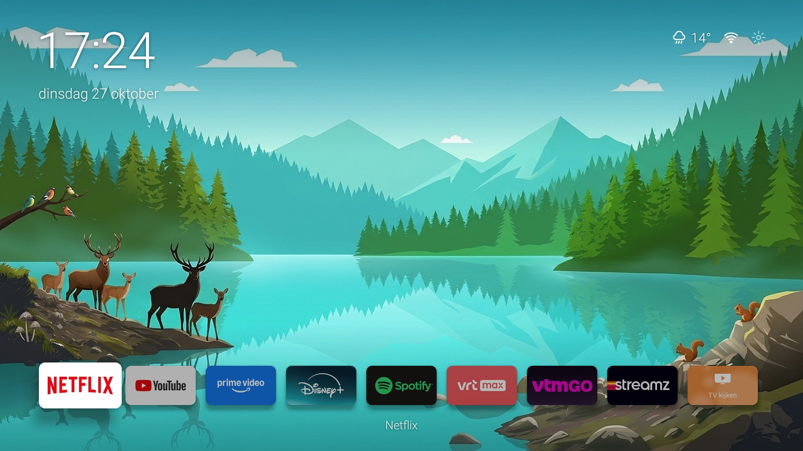
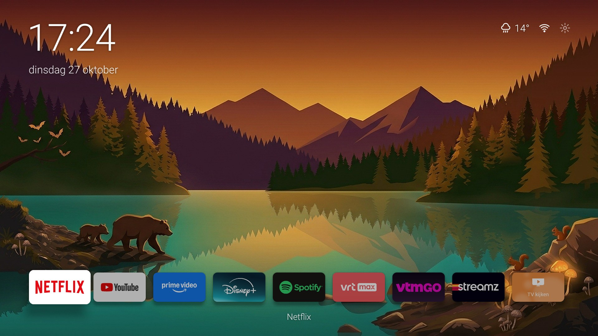
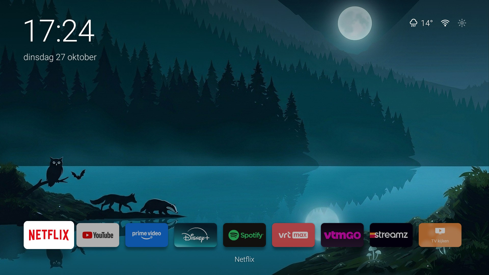
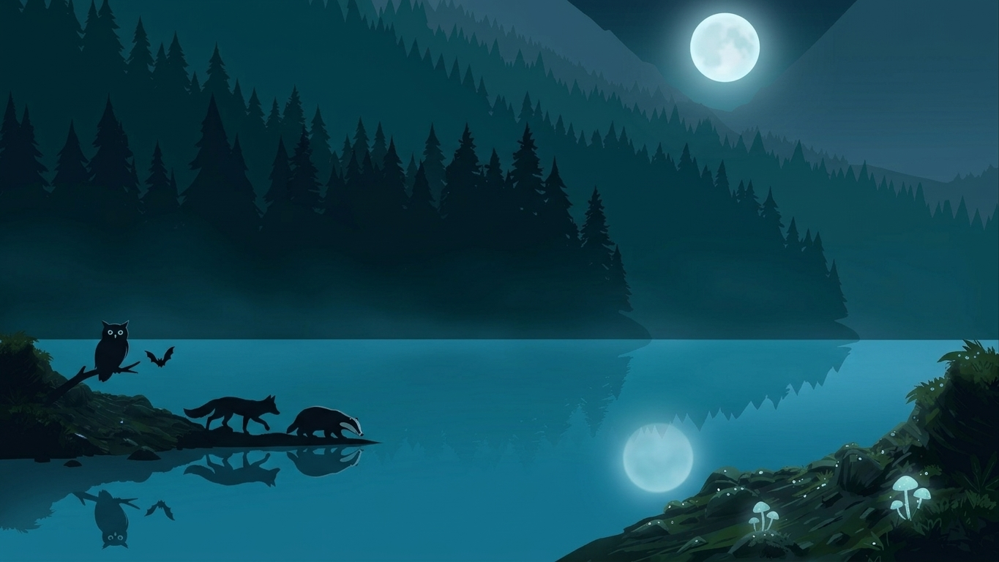
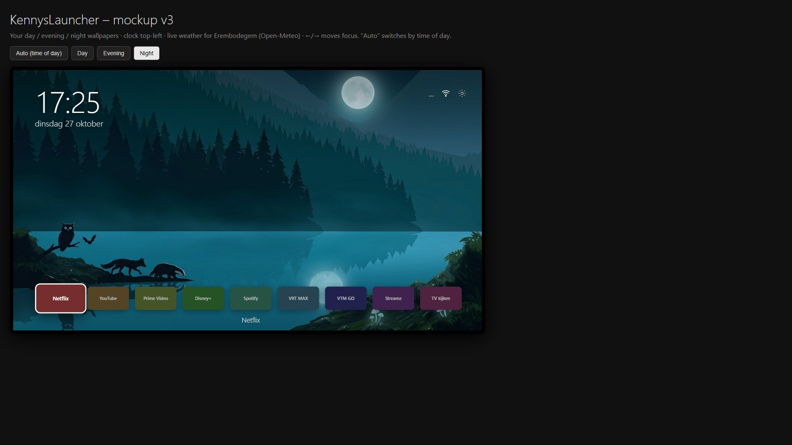

# Android TV Animalistic Launcher

A minimalistic, clutter-free home screen for Android TV: a big clock, live weather, one row of apps and a
hand-picked nature wallpaper that follows the real **sunrise and sunset**. No banners, no ads, no recommendations.



| Evening | Night |
|---|---|
|  |  |

> Screenshots are taken from the real TV (Philips 65PUS8102/12, Android TV 8.0, 1920x1080).
> App banners shown in the screenshots belong to their respective owners and are **not** part of this repository.
> The launcher reads them at runtime from the apps installed on the TV.

---

## Features

- **Big clock and date** in the top-left corner (`HH:mm` and the full weekday and date, Dutch/Belgian locale).
- **Live weather** (icon and temperature) from [Open-Meteo](https://open-meteo.com/). It needs no API key, refreshes every 30 minutes, and shows a moon icon on clear nights.
- **Network status icon** for Ethernet, Wi-Fi or offline.
- **Settings gear** that opens the system settings.
- **A single row of nine favorite apps** with their official TV banners, loaded from the installed apps. The focused tile grows and gets a white ring, and the other tiles are dimmed.
- **Wallpaper that changes with the sun.** It crossfades over 2 seconds between three phases:

  | Phase | When |
  |---|---|
  | Day | sunrise until 1 hour before sunset |
  | Evening | 1 hour before sunset until 1 hour after sunset |
  | Night | otherwise |

  Sunrise and sunset are calculated on the device (NOAA approximation), so no internet is needed for this.
- **No clutter.** It uses no AndroidX, no tracking, no ads or recommendation rows, and the BACK key does nothing on the home screen.
- **Small.** It is about 1.7 MB, and most of that is the three wallpapers.

## Repository layout

```
.
├── app/                          Android app (Kotlin, no AndroidX)
│   └── src/main/
│       ├── AndroidManifest.xml   HOME + LEANBACK_LAUNCHER activity
│       ├── java/be/kenny/launcher/
│       │   ├── MainActivity.kt   UI, app row, clock, weather, network, wallpaper switching
│       │   └── Sun.kt            Sunrise/sunset and day/evening/night phase logic
│       └── res/
│           ├── drawable/         Vector icons (weather, wifi, gear) + scrims/focus shapes
│           ├── drawable-nodpi/   bg_day.jpg, bg_dusk.jpg, bg_night.jpg (1920x1080)
│           └── layout/activity_main.xml
├── wallpapers/                   Original AI-generated wallpapers (1365x768)
├── docs/
│   ├── images/                   Screenshots, mockup render, history/ (early procedural experiment)
│   └── mockup/mockup.html        Interactive HTML design mockup (placeholder tiles)
├── tools/
│   ├── remote/                   Python Android TV Remote v2 helpers (pair, send keys)
│   ├── wallpaper/                Legacy procedural wallpaper generator (Pillow)
│   └── removed-packages.txt      Debloat log of what was removed/disabled on the TV
└── .github/workflows/build.yml   CI: builds the debug APK on each push
```

## Requirements

- **JDK 17**, for example [Microsoft Build of OpenJDK](https://learn.microsoft.com/java/openjdk/download), installed with `winget install Microsoft.OpenJDK.17`.
- **Android SDK** with `platforms;android-34` and `build-tools;34.0.0`. Android Studio works, or the command-line tools alone:
  ```powershell
  sdkmanager "platforms;android-34" "build-tools;34.0.0" "platform-tools"
  ```
- An **Android TV** device running Android 8.0 (API 26) or newer.
- Optional: Python 3.10 or newer for the tools in `tools/`.

The Gradle wrapper is included, so you don't need to install Gradle.
The build uses Gradle 8.7, Android Gradle Plugin 8.5.2 and Kotlin 1.9.24.

## Build

```powershell
git clone https://github.com/kennysaelen/Android-tv-animalistic-launcher.git
cd Android-tv-animalistic-launcher

# Tell Gradle where the SDK is (or set ANDROID_HOME). This file is git-ignored.
"sdk.dir=$($env:LOCALAPPDATA -replace '\\','\\')\\Android\\Sdk" | Set-Content local.properties

$env:JAVA_HOME = "C:\Program Files\Microsoft\jdk-17.0.21.21-hotspot"   # adjust to your JDK 17
.\gradlew.bat assembleDebug
```

Output: `app/build/outputs/apk/debug/app-debug.apk`

On Linux or macOS, use `./gradlew assembleDebug`.
Each push to `main` also builds the APK in GitHub Actions and attaches it as a workflow artifact.

## Install on the TV

1. Enable **developer options** on the TV: Settings → About → press *Build* 7 times.
2. Enable **USB debugging** (on some TVs called *Network debugging*).
3. Connect over the network and install:

   ```powershell
   adb connect <TV-IP>:5555
   adb install -r app\build\outputs\apk\debug\app-debug.apk
   ```

> **Troubleshooting ADB authorization:** if `adb devices` keeps showing `unauthorized` and the TV never shows
> the *Allow USB debugging?* dialog, do a **cold reboot**: pull the power plug, wait about 10 seconds, and plug it back in.
> The dialog appeared right after the TV booted.

### Make it the default home screen

**Gentle option (recommended).** This keeps the stock launcher installed and enabled, and only changes the preferred HOME activity:

```powershell
adb shell cmd package set-home-activity be.kenny.launcher/.MainActivity
```

To revert to the Google TV launcher:

```powershell
adb shell cmd package set-home-activity com.google.android.tvlauncher/.MainActivity
```

**Aggressive option.** This disables the stock launcher for the current user. You can undo it with `pm enable`:

```powershell
adb shell pm disable-user --user 0 com.google.android.tvlauncher
# undo:
adb shell pm enable com.google.android.tvlauncher
```

Pressing **HOME** on the remote now opens this launcher.

## Configuration

All configuration is in code. Edit it and rebuild.

| What | Where |
|---|---|
| Apps in the row (label, package, optional explicit activity) | `wanted` list at the top of `MainActivity.kt` |
| Location used for sunrise/sunset and weather | `Sun.LAT` / `Sun.LON` in `Sun.kt` |
| Weather time zone | `WEATHER_URL` in `MainActivity.kt` |
| Date locale | `dateFmt` in `MainActivity.kt` (`Locale("nl", "BE")`) |
| Phase boundaries (1 hour around sunset) | `Sun.phase()` in `Sun.kt` |
| Wallpapers | Replace `app/src/main/res/drawable-nodpi/bg_{day,dusk,night}.jpg` (1920x1080 recommended) |

The launcher hides apps that are not installed. To start an app, it uses the app's Leanback launch intent and
falls back to the regular launch intent. Some system apps need an explicit activity, such as Philips *Watch TV* (`org.droidtv.playtv/.PlayTvActivity`).

### Previewing a wallpaper phase

You can force a phase without waiting for sunset:

```powershell
adb shell am start -n be.kenny.launcher/.MainActivity --es phase day      # day | evening | night | auto
```

## Wallpapers

The three wallpapers in `wallpapers/` are AI-generated illustrations of the same lake scene at different times of day:

| Day | Evening | Night |
|---|---|---|
|  |  |  |

- **Day:** red deer, birds and squirrels.
- **Evening:** a calmer scene in golden light.
- **Night:** an owl, a bat, a fox, a badger and the moon.

To build the in-app versions (`bg_*.jpg`), I upscaled the originals from 1365x768 to 1920x1080 with Lanczos resampling and a light unsharp mask.
A top and bottom gradient scrim (`scrim_top.xml`, `scrim_bottom.xml`) keeps the clock and labels readable on bright skies.

`docs/images/history/` contains an earlier experiment: a fully **procedural** wallpaper generator
(`tools/wallpaper/make_wallpaper.py`) that drew mountains, trees and animal silhouettes with Pillow.
It was replaced by the illustrated wallpapers above.

## Design mockup

Open `docs/mockup/mockup.html` in a browser to try the layout with the keyboard (←/→ to move focus).
Add `?m=day`, `?m=dusk` or `?m=night` to the URL to force a phase.



## TV tools (optional)

`tools/remote/` contains small Python helpers built on
[`androidtvremote2`](https://github.com/tronikos/androidtvremote2), the Android TV Remote protocol v2. I used them to
pair with the TV and navigate it from a PC before ADB was available.

```powershell
cd tools\remote
pip install -r requirements.txt
$env:ATV_HOST = "192.168.1.50"          # your TV's IP
python pair.py                           # shows a code on the TV; enter it when prompted
python nav.py HOME DPAD_DOWNx2 DPAD_CENTER
```

Pairing creates `cert.pem` and `key.pem` next to the scripts. **These are credentials.** They are git-ignored, so never commit them.

`tools/removed-packages.txt` records which preinstalled packages were disabled or uninstalled on the test TV.
It is there for reference only. Review it before you apply anything to your own device.

## Tested on

- Philips 65PUS8102/12, Android TV 8.0 (API 26), 1920x1080 at 320 dpi.

The layout uses `dp` sizes, so it should scale to other 1080p and 4K TVs. Text sizes are also in `dp`, so the system font scale does not affect them.

## Privacy

- **Weather:** the launcher sends the configured latitude and longitude, rounded to town level, to `api.open-meteo.com`. It makes no other network calls.
- **Tracking:** it has no analytics, no tracking and no accounts.

## License

[GPL-3.0](LICENSE)

The wallpapers in this repository are AI-generated and are provided under the same license.
App names and banners shown in screenshots are trademarks of their respective owners.
